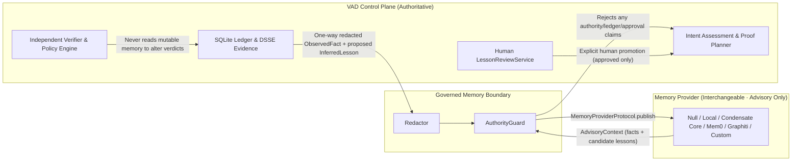

# Authority Boundaries: Authoritative Evidence vs. Interchangeable Memory

VAD enforces a strict trust and ownership boundary between **authoritative control-plane records** and **interchangeable, advisory memory providers**. A memory provider may enrich planning and retrospective analysis, but it never owns truth, authority, or release state.

---

## 1. Ownership Matrix

| Information / Artifact | Authoritative Owner | Interchangeable? | Governing Rule |
|---|---|---|---|
| **Executable Intent Packages (EIPs)** | VAD | No | Canonicalized and digest-pinned (`eip_digest`) in VAD. |
| **Proof obligations** (and proof plans) | VAD | No | Digest-bound to the EIP and evaluated by VAD proof mappers/runners. |
| **Verification results** (and freshness stamps) | VAD | No | Produced solely by an independent isolated verifier (`verifier_actor != builder_actor`) and validated by `FreshnessValidator`. |
| **Policy decisions** (and autonomy evaluations) | VAD | No | Evaluated deterministically by the VAD Policy Engine (Rego + Python) into `ReleaseDecision` records. |
| **Approval records** (and operator intent) | VAD | No | Signed/attested operator decisions persisted in the VAD SQLite ledger. |
| **Execution state** (work items, fenced leases, idempotency records, checkpoints) | VAD | No | Persisted in VAD's local SQLite store with monotonic `fence_token` guards. |
| **Authoritative evidence ledger** | VAD | No | Append-only, tamper-evident, Ed25519 DSSE-attested record in VAD. |
| **Historical knowledge** (and episode projections) | Memory Provider | Yes | One-way redacted projection of `ObservedFact` records linked to authoritative VAD evidence digests. |
| **Semantic retrieval** (and graph/provenance queries) | Memory Provider | Yes | Advisory context only (`AdvisoryContext`); absence or outage never blocks core verification. |
| **Lessons learned** (`InferredLesson` candidates) | Memory Provider | Yes | Strictly separated from observed facts; requires explicit human review and promotion before influencing policy or proof planning. |
| **Context consolidation** | Memory Provider | Yes | Optional provider capability advertised via `MemoryCapabilities`; never treated as authoritative evidence. |

---

## 2. Hard Security Invariants

The following invariants are non-negotiable and enforced across runtime guards (`AuthorityGuard`, `MemoryGateway`, `LessonReviewService`, `FreshnessValidator`) and static architecture tests (`tests/test_architecture_principles.py`):

1. **No Verification Tampering:** A memory provider must **never** alter verification results, bypass freshness checks, or convert a builder self-claim into an authoritative `VerificationResult`.
2. **No Approval Forgery:** A memory provider must **never** grant approvals, fabricate operator intent, or satisfy `HIGH` / `CRITICAL` sign-off requirements.
3. **No Policy Override:** A memory provider must **never** override policy decisions, downgrade an `EIP` risk tier or `AssuranceLevel`, or bypass the Risk × Evidence Autonomy Matrix.
4. **No Ledger Mutation:** A memory provider must **never** mutate the authoritative evidence ledger. No module under `vad/memory/` may import `ServerStore` or execute SQL `INSERT`, `UPDATE`, or `DELETE` statements against authoritative VAD tables (`run_evidence`, `approvals`, `work_items`, `diff_proposals`, `diff_apply_records`, `operator_intents`).
5. **Observed Facts vs. Inferred Lessons Separation:**
   - **Observed facts (`ObservedFact`)** are immutable, redacted, one-way projections of verified VAD events anchored by authoritative evidence digests (`eip_digest`, `run_id`, `evidence_digest`).
   - **Inferred lessons (`InferredLesson`)** are fallible candidate recommendations (`review_status`: `proposed | approved | rejected | superseded`) derived from outcomes or incidents. They must remain cleanly separated from observed facts.
6. **Human Review Required Before Policy Promotion:**
   - An inferred lesson **never** becomes active policy, a mandatory gate, or a default proof obligation automatically.
   - Explicit human review and approval (`review_status == "approved"`) recorded in VAD's `lesson_promotions` ledger is required before intent assessment or proof planning may incorporate the lesson. Unapproved (`proposed`, `rejected`, `superseded`) lessons MUST be ignored for authoritative planning.
7. **Core Package Isolation:**
   - Authoritative core packages (`vad/verify/`, `vad/policy/`, `vad/evidence/`, `vad/release/`) MUST remain isolated from external memory SDKs (`condensate`, `mem0`, `graphiti`, `qdrant`) and vendor LLM SDKs (`openai`, `anthropic`, `google.genai`, `vertexai`).
8. **Fail-Closed & Graceful Advisory Degradation:**
   - If the configured memory provider is `NullMemoryProvider` or an external provider is unreachable, `MemoryGateway` degrades gracefully (returning empty `AdvisoryContext`) while VAD verification, policy evaluation, and ledger recording proceed deterministically.

---

## 3. Data Flow Across the Boundary

### Enforcement Summary

- **Outbound (VAD → Memory Provider):** Only redacted `ObservedFact` records and `proposed` `InferredLesson` candidates cross through `Redactor` and `AuthorityGuard`. Secrets, raw credentials, and unredacted host transcripts are stripped.
- **Inbound (Memory Provider → VAD):** Retrieved `AdvisoryContext` is filtered through `AuthorityGuard`. Only `approved` lessons (verified against VAD's human-review promotion state) and advisory `ObservedFact` references inform planning; unapproved lessons are dropped, and any payload attempting to assert verification, approval, or policy authority is rejected.
- **Independent Audit (`verify_run_audit_trail`):** An operator auditing a run validates the entire chain from the authoritative VAD SQLite ledger and DSSE signatures alone, with zero reliance on external memory provider state.
