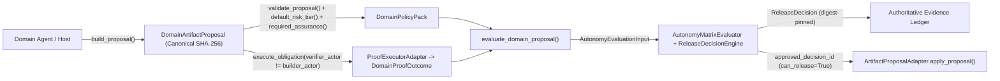

# Scope B Domain Packs: Extending VAD Beyond Software Delivery

Verified Agentic Development (VAD) separates its **domain-neutral control plane** (Intent, Proof, Freshness, Risk × Evidence Autonomy Matrix, Approvals, and Evidence Ledger) from **domain-specific execution semantics** behind a typed adapter seam in [domain_pack.py](file:///c:/LocalProjects/condensate-arch-docs/verified-agentic-development/vad/adapters/domain_pack.py).

This seam enables non-coding autonomous agents—across infrastructure, operations, business workflows, and compliance—to inherit VAD's fail-closed governance without modifying VAD core packages (`vad/verify/`, `vad/policy/`, `vad/evidence/`, `vad/release/`).

---

## 1. Scope A vs. Scope B Positioning

| Dimension | Scope A: Verified Software Delivery Platform | Scope B: General Autonomous Agent Control System |
|---|---|---|
| **Primary Domains** | Software engineering, CI/CD, code & test verification, incident-driven patches (`DomainKind.SOFTWARE_DELIVERY`) | Infrastructure (`INFRASTRUCTURE`), Operations (`OPERATIONS`), Business (`BUSINESS`), Compliance (`COMPLIANCE`) |
| **Artifact Proposals** | Git diffs, patch journals, PR/MR proposals | Canonical `DomainArtifactProposal` payloads (Terraform plans, Kubernetes manifests, IAM/firewall changes, compliance attestations) |
| **Proof Execution** | Isolated test ladders (`pytest`, linters, contract checks) | Domain-native checks via `ProofExecutorAdapter` (`terraform plan`, policy-as-code checks, OPA/SOC2 control audits) |
| **Governance & Ledger Core** | `EIP`, `FreshnessValidator`, `AutonomyMatrixEvaluator`, `ReleaseDecisionEngine`, DSSE Evidence Ledger | **Identical VAD core** (`AutonomyMatrixEvaluator`, `ReleaseDecisionEngine`, `ReleaseDecision`, Evidence Ledger digests) |
| **Core Modifications Required** | N/A | **None** — domain packs register via `DomainPackRegistry` |

---

## 2. Three Adapter Protocols & Control-Plane Flow

Every Scope B domain pack implements three `@runtime_checkable` protocols and registers them in `DomainPackRegistry`:



### Protocol Summary

1. **`ArtifactProposalAdapter`**
   - Declares `domain: DomainKind`.
   - `build_proposal(...) -> DomainArtifactProposal`: Normalizes a domain change into a `DomainArtifactProposal` with an auto-computed canonical SHA-256 `payload_digest` and an explicit `rollback_plan`.
   - `apply_proposal(proposal, *, approved_decision_id) -> dict[str, Any]`: Executes the domain mutation only after `ReleaseDecisionEngine` emits an authorized `ReleaseDecision`.
2. **`ProofExecutorAdapter`**
   - Declares `domain: DomainKind`.
   - `execute_obligation(proposal, obligation_id, *, verifier_actor) -> DomainProofOutcome`: Runs an independent, isolated check for a proof obligation and returns a digest-pinned `DomainProofOutcome`.
3. **`DomainPolicyPack`**
   - Declares `domain: DomainKind`.
   - `default_risk_tier(proposal) -> RiskTier`: Maps domain semantics (e.g., production VPC peering vs. staging tag update) to VAD `RiskTier` (`low`, `medium`, `high`, `critical`).
   - `required_assurance(proposal) -> AssuranceLevel`: Declares the target `AssuranceLevel` (`A1_BASIC`–`A4_RESTRICTED`). Note that `AutonomyMatrixEvaluator` still enforces VAD's mandatory floor per `RiskTier`, so a domain pack cannot weaken core risk-tier assurance requirements.
   - `validate_proposal(proposal) -> list[str]`: Performs domain structural/safety checks (e.g., rejecting empty `rollback_plan` or forbidden wildcard principals).

---

## 3. Core Invariants Preserved Across Scope B

Routing a `DomainArtifactProposal` through `evaluate_domain_proposal(...)` guarantees every Scope B domain inherits VAD's core safety guarantees:

- **Builder/Verifier Separation:** `evaluate_domain_proposal` enforces `verifier_actor != builder_actor` before and after proof execution (`PermissionError` on self-verification) and forwards both actors to `AutonomyMatrixEvaluator` to block builder self-approval.
- **Evidence-Driven Autonomy Matrix:** `HIGH` proposals block with `ReleaseOutcome.HUMAN_APPROVAL_REQUIRED` until at least one distinct human guardian approves (`ReleaseOutcome.APPROVED_WITH_HUMAN`); `CRITICAL` proposals block with `ReleaseOutcome.RESTRICTED_AUTHORIZATION_REQUIRED` until an explicit pre-run `explicit_authorization_ref` and two distinct human guardians approve (`ReleaseOutcome.APPROVED_RESTRICTED`).
- **Evidence Ledger Traceability:** Both `proposal.payload_digest` (`eip_digest`) and the canonical digest over validation results + `DomainProofOutcome` records (`evidence_digest`) are bound onto the immutable `ReleaseDecision`.

---

## 4. Example: Infrastructure & Compliance Agents Without Core Edits

```python
from vad.adapters.domain_pack import (
    DomainKind,
    DomainPack,
    DomainPackRegistry,
    evaluate_domain_proposal,
)
from vad.release.decision import ReleaseOutcome

registry = DomainPackRegistry()
registry.register(
    DomainPack(
        domain=DomainKind.INFRASTRUCTURE,
        proposal_adapter=terraform_adapter,
        proof_executor=terraform_plan_verifier,
        policy_pack=infra_policy_pack,
    )
)

infra_pack = registry.get(DomainKind.INFRASTRUCTURE)
proposal = infra_pack.proposal_adapter.build_proposal(
    target_resource="aws_security_group.prod_ingress",
    summary="Restrict HTTPS ingress to corporate CIDR",
    payload={"environment": "production", "cidr_blocks": ["10.20.0.0/16"]},
    rollback_plan="terraform apply -var-file=previous.tfvars",
)

# 1. Blocked before human guardian sign-off
blocked = evaluate_domain_proposal(
    infra_pack,
    proposal,
    run_id="run-infra-001",
    builder_actor="infra-agent",
    verifier_actor="policy-verifier-bot",
)
assert blocked.can_release is False
assert blocked.outcome == ReleaseOutcome.HUMAN_APPROVAL_REQUIRED

# 2. Approved once human guardian signs off -> ready for apply_proposal()
approved = evaluate_domain_proposal(
    infra_pack,
    proposal,
    run_id="run-infra-002",
    builder_actor="infra-agent",
    verifier_actor="policy-verifier-bot",
    human_approvers=["sre-lead"],
)
assert approved.can_release is True
assert approved.outcome == ReleaseOutcome.APPROVED_WITH_HUMAN
```
