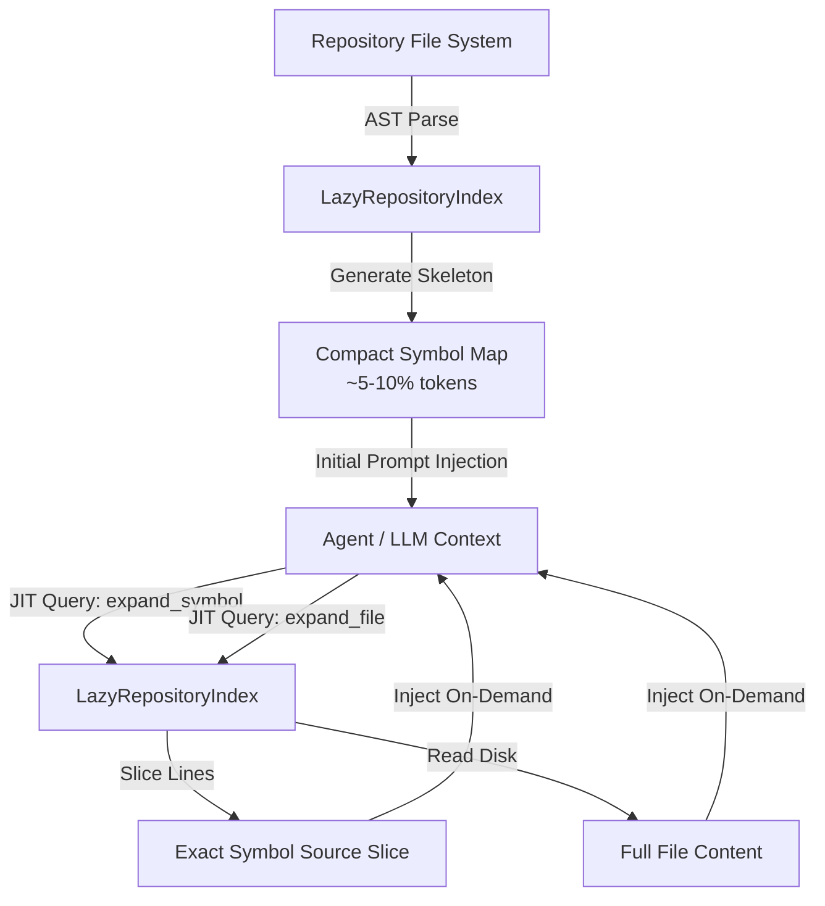

# Lazy-Index Pattern: Architectural Guide & Token Economics

## Overview

In autonomous agentic software development, injecting an entire codebase into an LLM's context window produces two critical problems:
1. **Exponential Token Costs**: Eager ingestion of hundreds of source files consumes hundreds of thousands of input tokens on every turn. In multi-turn sessions (20–50 turns), eager ingestion scales transcript costs to tens or hundreds of dollars per task.
2. **Context Dilution & Attention Degradation**: Flooding the prompt context with irrelevant implementation bodies impairs the model's ability to reason about constraints, architectural invariants, and verification gates.

The **Lazy-Index Pattern** implemented in `vad/context/lazy_index.py` resolves this dilemma by decoupling **symbol visibility** from **source code materialization**.

---

## Architectural Mechanics

The Lazy-Index Pattern operates across three deterministic phases:



### 1. Skeletal AST Indexing
The indexer scans the repository and parses source files using the language's Abstract Syntax Tree (`ast.parse` for Python):
- Extracts classes, methods, top-level functions, argument signatures, line spans (`line_start`, `line_end`), and docstring one-liners.
- Omits all function and method implementation bodies.
- Computes SHA-256 hashes of source files to support fast incremental re-indexing without rescanning unchanged files.

### 2. Compact Symbol Skeleton Injection
During session initialization (e.g. `SessionStartHook` or system prompt assembly), only the skeletal symbol tree is injected:
```text
File: vad/verify/runner.py
  [class] CostOrderedLadderRunner - "Runs cost-ordered verification ladder..." (L24-L120)
  [method] CostOrderedLadderRunner.run(files, mees) - "Executes ladder steps in cost order..." (L45-L88)
```
This gives the agent complete spatial awareness of all classes, methods, and functions across the entire repository while consuming **85% to 95% fewer tokens** than the raw source files.

### 3. JIT Materialization (On-Demand Expansion)
When an agent determines it needs to read or modify a specific symbol:
- It requests the symbol via `expand_symbol("CostOrderedLadderRunner.run")`.
- `LazyFileIndex.get_symbol_source()` slices the exact line range from disk.
- Only the targeted symbol is materialized into the conversation transcript.

---

## Token Economics & Cost Reduction

Under the Verified Agentic Development transcript-exact accounting model (`vad/audit/cost_report.py`):

| Metric | Eager Ingestion | Lazy-Index Pattern | Savings |
|---|---|---|---|
| **Initial Context Size** | 120,000 tokens | 7,500 tokens | **93.75% reduction** |
| **Turns per Session** | 30 turns | 30 turns | - |
| **Cumulative Prompt Tokens** | 3,600,000 tokens | 225,000 tokens (skeletal) + 40,000 (JIT expanded) = 265,000 | **92.6% reduction** |
| **Session Prompt Cost (Sonnet $3/M)** | \$10.80 | \$0.79 | **\$10.01 saved per session** |
| **Annualized Cost (50 runs/day)** | \$197,100 | \$14,417 | **\$182,683 annual savings** |

---

## Integration with VAD Components

1. **`vad.audit.cost_report`**:
   The exact prompt and completion token accounting uses `TranscriptTurnUsage` to measure exact cost savings between lazy-indexed sessions and eager baselines.

2. **Claude Code Hooks (`vad/plugins/claude_code/hooks/`)**:
   - `session_start.py`: Loads the cached skeletal index and injects the high-level symbol map into the session context.
   - `pre_tool_use.py`: Prevents runaway tool reads by checking if the requested file/symbol can be resolved through the index before granting raw disk access.

3. **Disk Cache & Invalidation**:
   The index is serialized to `.vad/lazy_index.json`. On subsequent invocations, files with matching SHA-256 hashes bypass AST re-parsing, achieving sub-second startup times even on large repositories.
