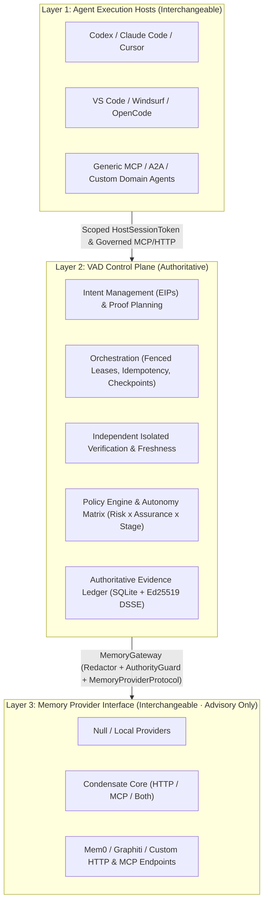

# VAD Product Design Principles & Core Architecture

Verified Agentic Development (VAD) is a **model-agnostic, host-agnostic, memory-agnostic, evidence-driven autonomy control plane**. It governs how autonomous agents propose, verify, and ship changes while keeping authoritative intent, verification, policy, and audit state strictly under operator control.

---

## 1. The Nine Product Design Principles

Every VAD subsystem, contract, and adapter MUST uphold the following nine enforceable design principles:

| # | Principle | Definition | Enforceable Architectural Rule |
|---|---|---|---|
| 1 | **Model-agnostic** | No hard dependency on any model vendor or inference API. | Core packages (`vad/verify/`, `vad/policy/`, `vad/evidence/`, `vad/release/`) MUST NOT import vendor LLM SDKs (`openai`, `anthropic`, `google.genai`, `vertexai`). Model execution happens behind provider routers or external host runtimes. |
| 2 | **Host-agnostic** | Govern multiple agent execution hosts through one shared protocol. | Codex, Claude Code, Cursor, VS Code, Windsurf, OpenCode, Generic MCP/A2A, and custom domain hosts integrate via scoped `HostSessionToken` bindings and governed MCP/HTTP contracts without host-specific privilege bypasses. |
| 3 | **Memory-agnostic** | Operate cleanly with zero external memory or with any conformant memory adapter. | All memory reads/writes flow through `MemoryGateway` and `MemoryProviderProtocol`. VAD MUST operate deterministically with `NullMemoryProvider` and tolerate offline/degraded external memory services. |
| 4 | **Local-first** | Run completely on operator-owned local infrastructure by default. | Local SQLite state, isolated local verification, local Ed25519 keys (`.vad/keys/`), and offline deterministic test suites require no hosted SaaS, cloud dashboard, or live external credentials. |
| 5 | **Evidence-first** | Acceptance and release decisions require fresh, independently verified, attested evidence. | Builder self-claims never satisfy proof obligations. `VerificationResult` records MUST be produced by an independent verifier (`verifier_actor != builder_actor`), pass `FreshnessValidator` checks, and be DSSE-attested. |
| 6 | **Policy-driven** | Authority is granted dynamically via Risk × Evidence policy evaluation. | Autonomy across `low`, `medium`, `high`, and `critical` risk tiers and across `build`, `ci_cd`, `deploy`, `runtime`, and `drift` stages is evaluated explicitly by the VAD Policy Engine (Rego + Python) into replayable `ReleaseDecision` records. |
| 7 | **Recoverable** | Interrupted runs resume safely without duplicate mutations or split-brain writes. | Orchestration combines durable stage `RunCheckpoint` records, persisted `IdempotencyRecord` keys, and monotonic lease `fence_token` enforcement (`409` on stale/zombie writes). |
| 8 | **Extensible** | Versioned interfaces and domain seams allow clean expansion without core rewrites. | External capabilities use versioned contracts (`MEMORY_INTERFACE_VERSION`), `MemoryCapabilities` discovery, dual-transport (`http` / `mcp`) configs, and clean domain-pack adapters for Scope A → Scope B extension. |
| 9 | **Verifiable** | Independent operators can audit and replay every run from the authoritative ledger alone. | `verify_run_audit_trail` validates EIP digests, proof plan coverage, freshness, builder/verifier separation, Ed25519 DSSE signatures, release decisions, approvals, and checkpoints without trusting builders or memory providers. |

---

## 2. Three-Layer Independence Architecture

VAD separates **who executes the model**, **who governs and verifies the work**, and **who stores advisory historical memory**. None of the three layers is locked to a single vendor or runtime:

### Layer Responsibilities

1. **Agent Execution Hosts (Interchangeable):**
   - Codex, Claude Code, Cursor, VS Code, Windsurf, OpenCode, Generic MCP/A2A, and custom or domain-specific agents.
   - Hosts propose edits, run builder workflows, or execute domain tasks. VAD governs them through scoped sessions and role isolation rather than competing for model execution.
2. **VAD Control Plane (Authoritative):**
   - Owns Executable Intent Packages (`EIP`), proof obligations, work-item scheduling, monotonic fenced leases, idempotency, durable checkpoints, independent verification, Risk × Evidence policy evaluation, release decisions, operator approvals, and the append-only DSSE-attested evidence ledger.
   - Core verification, policy, evidence, and release modules have **zero direct imports** of external memory SDKs or vendor LLM SDKs.
3. **Memory Provider Interface (Interchangeable · Advisory Only):**
   - Exposes `MemoryProviderProtocol` (`1.0.0`), `MemoryCapabilities` discovery, `MemoryProviderConfig` (`transport: http | mcp | both`), and conformance suites.
   - Supports `null`, `local`, `condensate_core` (reference provider with optional advanced capabilities such as semantic search, causal graph, contradiction resolution, context consolidation, and provenance traversal), `mem0`, `graphiti`, `custom_http`, and `custom_mcp` targets.
   - Memory providers supply **advisory context only** and never hold authoritative state (see [authority-boundaries.md](file:///c:/LocalProjects/condensate-arch-docs/verified-agentic-development/docs/architecture/authority-boundaries.md)).

---

## 3. Platform Positioning: Scope A → Scope B

VAD focuses near-term delivery on software engineering while keeping core governance primitives domain-neutral behind clean adapter seams:

| Positioning | Domain | Core Mechanism |
|---|---|---|
| **Scope A (Primary Near-Term Delivery): Verified Software Delivery Platform** | Software engineering, CI/CD, code & test verification, incident-driven fixes | Change-request `EIP`s, code/test proof ladders, isolated verifier execution, Risk × Assurance × Freshness release gates, and closed-loop outcome learning. |
| **Scope B (Extension via Adapter Seams): General Autonomous Agent Control System** | Operational, infrastructure, business, and compliance agents | Domain adapter protocols (`ArtifactProposalAdapter`, `ProofExecutorAdapter`, `DomainPolicyPack`) plug into VAD's intent, proof, policy, approval, and evidence ledger core without core rewrites. |

### Scope A → Scope B Invariant

- Domain-specific proposal formats, proof executors, and policy packs live behind adapter protocols.
- The VAD control plane treats `EIP` intent digests, proof satisfaction, policy decisions, approvals, and DSSE-signed evidence as domain-independent invariants.

---

## 4. Evolution Trajectory (Stages 01–04)

VAD progresses across four capability stages while preserving the same authoritative core and local-first defaults:

| Stage | Name | Focus & Capabilities |
|---|---|---|
| **Stage 01** | **Verified Agentic Development** | Local-first governed coding sessions, scoped `EIP` contracts, cost-ordered proof ladders, local DSSE attestations, and explicit operator approvals. |
| **Stage 02** | **Verified Software Delivery** | End-to-end delivery control plane: `AssuranceLevel` (`A1_BASIC`–`A4_RESTRICTED`), `FreshnessPolicy`, independent isolated verification (`verifier != builder`), Risk × Evidence Autonomy Matrix (`ReleaseDecision`), outcome metrics, and closed-loop advisory learning via `MemoryProviderProtocol`. |
| **Stage 03** | **Autonomous Software Engineering** | Multi-work-item programme decomposition (hierarchical intent keeping `EIP` as the atomic verification contract), fenced multi-host orchestration, checkpoint recovery, and opt-in operator-hosted remote workers. |
| **Stage 04** | **Continuous Verified Operations** | Incident-triggered `EIP` lifecycle (`EIPSeeder`), runtime and drift stage policy evaluation, continuous verification against live operational signals, and post-incident `ObservedFact` / candidate `InferredLesson` capture. |
