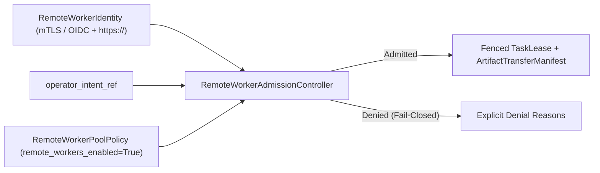

# Opt-In Operator-Hosted Remote Workers & Enterprise Controls

VAD preserves **local-first execution** (`WorkerExecutionMode.LOCAL_FIRST`) as its zero-configuration default with **zero mandatory hosted SaaS**. Teams running self-hosted enterprise build farms or isolated verifier pools can optionally enable **operator-hosted remote workers** (`WorkerExecutionMode.OPERATOR_HOSTED_REMOTE`) behind fail-closed admission, mutual authentication, content-addressed artifact transfers, and RBAC release-guardian controls.

---

## 1. Local-First Default & Explicit Opt-In Boundary

| Property | Default (`local_first`) | Opt-In (`operator_hosted_remote`) |
|---|---|---|
| **Control Plane Ownership** | Operator workstation / local host | Operator-hosted infrastructure (no vendor SaaS) |
| **`remote_workers_enabled`** | `False` (all remote admission denied) | `True` (explicit operator configuration required) |
| **`require_operator_intent_for_remote`** | `True` | `True` (valid `operator_intent_ref` required) |
| **External SaaS / Tenancy** | None | None |

`RemoteWorkerPoolPolicy` defaults to `mode = WorkerExecutionMode.LOCAL_FIRST` and `remote_workers_enabled = False`. Even if `mode` is set to `OPERATOR_HOSTED_REMOTE`, `RemoteWorkerAdmissionController.admit_worker(...)` fails closed unless `remote_workers_enabled` is explicitly `True`.

---

## 2. mTLS & OIDC Worker Identity and Admission

Remote workers authenticate to the operator-hosted control plane using `WorkerAuthMethod.MTLS` or `WorkerAuthMethod.OIDC`, represented by `RemoteWorkerIdentity`:

- **Identity & Role Scoping:** Each worker declares `worker_id`, `host_type` (`codex`, `claude_code`, `cursor`, `verifier_runner`, `custom`), `role` (`HostRole`), and `allowed_risk_tiers` (`list[RiskTier]`).
- **Mutual Subject & Config References:** `identity_subject` captures the mTLS CN/SAN or OIDC `sub`, while `cert_or_issuer_ref` holds a configuration or secret reference (for example, a PKI path, SPIFFE ID, or OIDC issuer URI). Raw private keys, bearer tokens, and inline secrets are rejected at schema validation.
- **Transport Security:** `endpoint_url` enforces `https://` for remote hosts; plaintext `http://` is permitted only for local loopback contract verification (`127.0.0.1`, `localhost`, `::1`) and rejected for any non-local host. Embedded URL credentials (`user:pass@`) are also rejected.
- **Fail-Closed Admission (`RemoteWorkerAdmissionController.admit_worker`):**
  1. Denies admission if `remote_workers_enabled` is `False`.
  2. Denies admission if `require_operator_intent_for_remote` is `True` and `operator_intent_ref` is missing or blank.
  3. Denies admission if `worker.auth_method` is not listed in `policy.allowed_auth_methods`.

---

## 3. Content-Addressed Artifact Transfers (`ArtifactTransferManifest`)

Artifacts produced or consumed across operator-hosted worker boundaries are bound to a run, work item, and monotonic lease fence token via `ArtifactTransferManifest`:

- **Lease Fence Binding:** `fence_token` (`>= 1`) ties transferred artifacts to the active `TaskLease` generation, preventing stale or split-brain workers from injecting artifacts.
- **Path Traversal & Absolute Path Protection:** Every key in `artifacts` must be a relative POSIX path without `..`, `.`, backslashes, drive prefixes, control characters, or leading `/`.
- **Constant-Time SHA-256 Verification:** Each artifact path maps to a 64-character lowercase SHA-256 hex digest. `ArtifactTransferManifest.verify_payload_digest(path, data)` verifies payload bytes in constant time (`hmac.compare_digest`) and returns `False` for unknown paths or mismatched bytes.

---

## 4. Enterprise RBAC Release-Guardian Controls

For organizations integrating enterprise identity groups into release governance, `RemoteWorkerPoolPolicy.rbac_release_guardian_groups` lists authorized release-guardian group identifiers:

- `RemoteWorkerAdmissionController.authorize_release_guardian_group(actor_groups)` evaluates whether the actor's presented groups intersect the configured `rbac_release_guardian_groups`.
- **Fail-Closed Semantics:** When `rbac_release_guardian_groups` is empty or no presented group matches, `authorize_release_guardian_group` returns `False`.
- Enterprise RBAC checks supplement—and never weaken—VAD's core separation invariants (`verifier != builder`, freshness checks, and DSSE evidence verification).

---

## 5. Fenced Dispatch, Receipts, Coordinator & Audit Verification

### 5.1 Dispatch Envelopes, Execution Receipts & Bundle Verification ([`remote_workers.py`](../../vad/control_plane/remote_workers.py))

- **`RemoteDispatchEnvelope`:** Binds `dispatch_id`, `worker_id`, `run_id`, `work_item_id`, `eip_digest`, `proof_plan_digest`, `risk_tier`, `required_role`, `fence_token` (`>= 1`), `operator_intent_ref`, and an `input_manifest: ArtifactTransferManifest` whose `run_id`, `work_item_id`, and `fence_token` must match the envelope.
- **`RemoteExecutionReceipt`:** Returned by a remote worker with `receipt_id`, `dispatch_id`, `worker_id`, `run_id`, `work_item_id`, `fence_token` (`>= 1`), `actor`, `role`, `passed`, `summary`, and a bound `output_manifest: ArtifactTransferManifest`.
- **`ArtifactTransferManifest.verify_bundle(payloads, *, allow_extra_files=False)`:** Verifies completeness of every expected artifact path, constant-time SHA-256 digest matching (`verify_payload_digest`), and rejects unexpected unlisted payloads by default, returning `(ok, failures)`.
- **Admission Controller Dispatch & Receipt Checks:**
  - `RemoteWorkerAdmissionController.authorize_dispatch(worker, envelope, *, active_fence_token=None, builder_actor=None)` re-runs `admit_worker`, verifies `worker_id`, `worker.role == envelope.required_role`, `envelope.risk_tier in worker.allowed_risk_tiers`, monotonic `envelope.fence_token >= active_fence_token`, and enforces `HostRole.VERIFIER` separation from `builder_actor`.
  - `RemoteWorkerAdmissionController.verify_execution_receipt(worker, envelope, receipt, *, output_payloads=None, active_fence_token=None)` verifies receipt-to-envelope binding (`dispatch_id`, `worker_id`, `run_id`, `work_item_id`, `role`, `fence_token`), active fence match, and `receipt.output_manifest.verify_bundle(output_payloads)` when payloads are supplied.

### 5.2 `RemoteWorkerCoordinator` ([`remote_worker_coordinator.py`](../../vad/control_plane/remote_worker_coordinator.py))

`RemoteWorkerCoordinator` wires admission, fenced dispatch, scoped session issuance, receipt ingestion, and RBAC co-authorization over SQLite Schema v13:

- **`register_worker` / `get_worker` / `list_workers`:** Evaluates `admit_worker` and persists admitted workers in Schema v13 `remote_workers`.
- **`dispatch_work(envelope, *, input_payloads=None, builder_actor=None) -> RemoteDispatchSession`:** Calls `authorize_dispatch`, verifies optional `input_payloads` via `input_manifest.verify_bundle`, updates the monotonic `fence_token`, persists `input_manifest` to `artifact_transfer_manifests`, and issues a scoped `HostSessionToken` (1-hour TTL) via `HostSessionManager` bound to `worker.worker_id`, `worker.host_type`, `envelope.required_role`, `envelope.work_item_id`, and `envelope.fence_token`.
- **`ingest_execution_receipt(receipt, *, output_payloads=None) -> RemoteReceiptVerificationResult`:** Calls `verify_execution_receipt` against the active dispatch and fence token, and persists verified `output_manifest` records to `artifact_transfer_manifests`.
- **`authorize_release_with_rbac(*, actor_groups_by_guardian, risk_tier, builder_actor, verifier_actor) -> RBACReleaseAuthorizationResult`:** Enforces builder non-self-approval (`guardian_id != builder_actor`), checks `authorize_release_guardian_group(groups)` for each guardian, and requires at least `1` authorized guardian for `RiskTier.HIGH` and `2` distinct authorized guardians for `RiskTier.CRITICAL`.

### 5.3 Independent Audit Check, Schema v13 Tables & CLI/HTTP Routes

- **Schema v13 Persistence (`ServerStore`):** `remote_workers` (keyed by `worker_id` with `host_type`, `role`, `auth_method`, `endpoint_url`, `operator_intent_ref`) and `artifact_transfer_manifests` (keyed by `transfer_id` with `run_id`, `work_item_id`, `fence_token`).
- **Independent Audit Trail Verification:** [`verify_run_audit_trail`](../../vad/audit/verify_trail.py) runs the `artifact_transfer_manifests` check whenever manifests exist for a `run_id`, `artifact_payloads` are provided, or `require_transfer_manifests=True`—validating `run_id` match, `fence_token >= 1`, 64-character lowercase SHA-256 hex digests, and optional payload bundle verification via `manifest.verify_bundle`.
- **CLI & HTTP Surface:**
  - CLI: `vad remote-workers list [--db .vad/control-plane/vad.sqlite3] [--role <role>]`
  - HTTP:
    - `GET /remote-workers` (optional `?role=...`)
    - `POST /remote-workers/admit`
    - `POST /remote-workers/manifests`
    - `GET /remote-workers/manifests` (optional `?run_id=...&work_item_id=...`)
