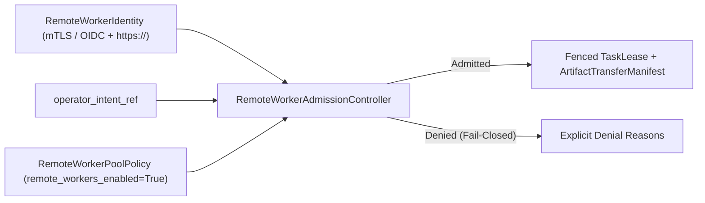

# Opt-In Operator-Hosted Remote Workers & Enterprise Controls

VAD preserves **local-first execution** (`WorkerExecutionMode.LOCAL_FIRST`) as its zero-configuration default with **zero mandatory hosted SaaS**. Teams running self-hosted enterprise build farms or isolated verifier pools can optionally enable **operator-hosted remote workers** (`WorkerExecutionMode.OPERATOR_HOSTED_REMOTE`) behind fail-closed admission, mutual authentication, content-addressed artifact transfers, and RBAC release-guardian controls.

---

## 1. Local-First Default & Explicit Opt-In Boundary

| Property | Default (`local_first`) | Opt-In (`operator_hosted_remote`) |
|---|---|---|
| **Control Plane Ownership** | Operator workstation / local host | Operator-hosted infrastructure (no vendor SaaS) |
| **`remote_workers_enabled`** | `False` (all remote admission denied) | `True` (explicit operator configuration required) |
| **`require_operator_intent_for_remote`** | `True` | `True` (valid `operator_intent_ref` required) |
| **External SaaS / Tenancy** | None | None |

`RemoteWorkerPoolPolicy` defaults to `mode = WorkerExecutionMode.LOCAL_FIRST` and `remote_workers_enabled = False`. Even if `mode` is set to `OPERATOR_HOSTED_REMOTE`, `RemoteWorkerAdmissionController.admit_worker(...)` fails closed unless `remote_workers_enabled` is explicitly `True`.

---

## 2. mTLS & OIDC Worker Identity and Admission

Remote workers authenticate to the operator-hosted control plane using `WorkerAuthMethod.MTLS` or `WorkerAuthMethod.OIDC`, represented by `RemoteWorkerIdentity`:

- **Identity & Role Scoping:** Each worker declares `worker_id`, `host_type` (`codex`, `claude_code`, `cursor`, `verifier_runner`, `custom`), `role` (`HostRole`), and `allowed_risk_tiers` (`list[RiskTier]`).
- **Mutual Subject & Config References:** `identity_subject` captures the mTLS CN/SAN or OIDC `sub`, while `cert_or_issuer_ref` holds a configuration or secret reference (for example, a PKI path, SPIFFE ID, or OIDC issuer URI). Raw private keys, bearer tokens, and inline secrets are rejected at schema validation.
- **Transport Security:** `endpoint_url` enforces `https://` for remote hosts; plaintext `http://` is permitted only for local loopback contract verification (`127.0.0.1`, `localhost`, `::1`) and rejected for any non-local host. Embedded URL credentials (`user:pass@`) are also rejected.
- **Fail-Closed Admission (`RemoteWorkerAdmissionController.admit_worker`):**
  1. Denies admission if `remote_workers_enabled` is `False`.
  2. Denies admission if `require_operator_intent_for_remote` is `True` and `operator_intent_ref` is missing or blank.
  3. Denies admission if `worker.auth_method` is not listed in `policy.allowed_auth_methods`.

---

## 3. Content-Addressed Artifact Transfers (`ArtifactTransferManifest`)

Artifacts produced or consumed across operator-hosted worker boundaries are bound to a run, work item, and monotonic lease fence token via `ArtifactTransferManifest`:

- **Lease Fence Binding:** `fence_token` (`>= 1`) ties transferred artifacts to the active `TaskLease` generation, preventing stale or split-brain workers from injecting artifacts.
- **Path Traversal & Absolute Path Protection:** Every key in `artifacts` must be a relative POSIX path without `..`, `.`, backslashes, drive prefixes, control characters, or leading `/`.
- **Constant-Time SHA-256 Verification:** Each artifact path maps to a 64-character lowercase SHA-256 hex digest. `ArtifactTransferManifest.verify_payload_digest(path, data)` verifies payload bytes in constant time (`hmac.compare_digest`) and returns `False` for unknown paths or mismatched bytes.

---

## 4. Enterprise RBAC Release-Guardian Controls

For organizations integrating enterprise identity groups into release governance, `RemoteWorkerPoolPolicy.rbac_release_guardian_groups` lists authorized release-guardian group identifiers:

- `RemoteWorkerAdmissionController.authorize_release_guardian_group(actor_groups)` evaluates whether the actor's presented groups intersect the configured `rbac_release_guardian_groups`.
- **Fail-Closed Semantics:** When `rbac_release_guardian_groups` is empty or no presented group matches, `authorize_release_guardian_group` returns `False`.
- Enterprise RBAC checks supplement—and never weaken—VAD's core separation invariants (`verifier != builder`, freshness checks, and DSSE evidence verification).
