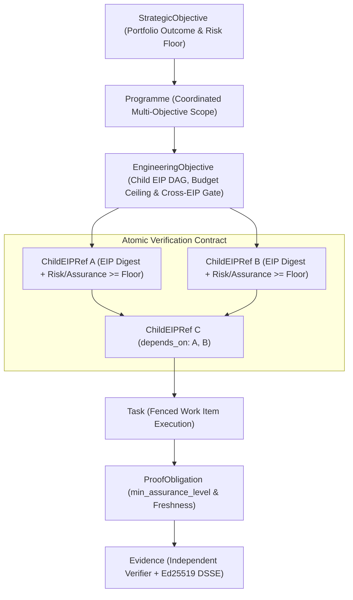

# RFC: Hierarchical Intent Model & Multi-EIP Rollup Governance

- **Status:** Proposed (Prototype Contracts Implemented)
- **Scope:** Stage 03 (Autonomous Software Engineering) & Scope B Domain Extensions
- **Related Docs:** [principles.md](principles.md), [authority-boundaries.md](authority-boundaries.md)
- **Prototype Contracts:** [`vad/contracts/intent_hierarchy.py`](../../vad/contracts/intent_hierarchy.py)

---

## 1. Problem Statement & Motivation

In Stage 01 and Stage 02, VAD governs single work items through an **Executable Intent Package (`EIP`)**. Each `EIP` defines a bounded goal, non-goals, risk tier, assurance level, freshness policy, invariants, constraints, proof obligations, tool permissions, and model budget, and produces an immutable `eip_digest` bound into DSSE-signed verification evidence and `ReleaseDecision` records.

While a flat `EIP` works well for a single change request, larger engineering efforts—such as multi-service migrations, cross-module refactors, or coordinated feature programmes—require decomposing a high-level objective into multiple parallel and dependent changes. Without a first-class hierarchy above `EIP`:

1. **Governance gaps:** An agent decomposing a large objective into smaller tasks can fragment high-risk work into multiple low-risk changes or split budgets across unlinked `EIP`s to bypass ceilings.
2. **Missing rollup verification:** Passing five individual `EIP`s does not guarantee their cross-component integration invariants hold or that all child evidence remains fresh at release time.
3. **Ad-hoc dependency ordering:** Parallel vs. sequential execution order across related `EIP`s has no canonical DAG representation.
4. **Unclear partial-failure semantics:** When one child `EIP` fails verification or drifts, independent sibling `EIP`s lack an explicit coordinated release/rollback policy.

This RFC evaluates whether flat `EIP`s remain sufficient or whether VAD should adopt a **Hierarchical Intent Model**:

```text
StrategicObjective → Programme → EngineeringObjective → EIP (atomic verification contract) → Task → ProofObligation → Evidence
```

---

## 2. Design Options Considered

### Option A: Flat `EIP`s + Metadata Tags

Keep the existing flat `EIP` schema and represent parent/child relationships solely via free-form tags or `parent_eip` string annotations on each `EIP`.

- **Pros:** Zero new schema types; minimal surface area.
- **Cons:**
  - No authoritative parent node exists to enforce non-downgradable `RiskTier` or `AssuranceLevel` floors across children.
  - No aggregate budget or blast-radius ceiling enforcement across sibling `EIP`s.
  - Cross-`EIP` integration proof obligations have nowhere authoritative to live.
  - Rollup status and coordinated release/rollback cannot be evaluated deterministically by the policy engine.

### Option B: Hierarchical Intent DAG Keeping `EIP` as Atomic Verification Leaf **[Recommended]**

Introduce typed parent intent layers (`StrategicObjective → Programme → EngineeringObjective`) **above** `EIP`, and structured execution/verification primitives (`Task → ProofObligation → Evidence`) **below** `EIP`, while keeping `EIP` itself as the immutable, digest-pinned atomic verification contract.



- **Pros:**
  - **Preserves existing core invariants:** `EIP`, `FreshnessValidator`, `IsolatedVerifierExecutor`, `ReleaseDecision`, and `verify_run_audit_trail` remain intact and operate on the exact same `EIP` leaf contract.
  - **Clear decomposition boundary:** Planning agents propose child `EIP` DAGs under an `EngineeringObjective`, and governance rules enforce approval before dispatch.
  - **Deterministic DAG scheduling & rollup:** `EngineeringObjective.child_eips` forms an acyclic dependency graph (`depends_on`) that cleanly partitions into parallel execution tranches and rolls up into a verifiable parent verdict.
- **Cons:** Adds three parent node schemas (`StrategicObjective`, `Programme`, `EngineeringObjective`) and rollup validation functions.

### Option C: Recursive Polymorphic Intent (Arbitrary-Depth Self-Referential `EIP`s)

Allow any `EIP` to contain arbitrary nested child `EIP`s to unbounded depth, making every node in the tree simultaneously a planning container and a verification unit.

- **Pros:** Uniform recursive data model.
- **Cons:**
  - Blurs the boundary between an atomic, digest-pinned change contract (`EIP`) and a mutable planning container (`EngineeringObjective`).
  - Complicates `FreshnessPolicy` and DSSE attestation (parent digests would invalidate whenever any descendant metadata changes).
  - Makes audit-trail verification (`verify_run_audit_trail`) and Rego policy evaluation significantly harder to reason about and bound.

### Comparison Matrix

| Criterion | Option A: Flat `EIP` + Tags | Option B: Hierarchical DAG + Atomic `EIP` Leaf *(Recommended)* | Option C: Recursive Polymorphic `EIP` |
|---|---|---|---|
| **Verification Atomicity** | Strong (flat `EIP`) | **Strong** (`EIP` stays atomic leaf) | Weak (mixed container + leaf) |
| **Decomposition Governance** | None (ad-hoc) | **Explicit (`DRAFT` → `AWAITING_APPROVAL` → `APPROVED`)** | Complex (recursive approvals) |
| **Floor Inheritance** | Not enforceable | **Enforced at parent → child boundary** | Ambiguous across arbitrary depth |
| **Budget & Blast-Radius Ceiling** | Vulnerable to splitting | **Enforced via `max_total_cost_usd` rollup** | Difficult to bound cleanly |
| **Cross-`EIP` Proof Obligations** | Unsupported | **First-class (`cross_eip_proof_passed`)** | Coupled to parent `EIP` mutation |
| **Audit & Replay Simplicity** | Simple but incomplete | **Clean separation of planning DAG vs. leaf DSSE evidence** | High complexity |
| **Backward Compatibility** | 100% | **100% (existing flat `EIP`s need no parent)** | Requires rewriting core `EIP` schema |

**Decision:** Adopt **Option B**. Existing standalone `EIP`s continue to work unchanged, while multi-work-item engineering initiatives use `StrategicObjective → Programme → EngineeringObjective` over a DAG of `ChildEIPRef` leaves.

---

## 3. Concrete Governance Rules

### Rule 1: Decomposition Governance (Approval Before Dispatch)

An agent may propose a decomposition of an `EngineeringObjective` into a `ChildEIPRef` DAG, starting in `DecompositionStatus.DRAFT` or `DecompositionStatus.AWAITING_APPROVAL`.

- **Pre-dispatch gate:** No child `EIP` in the decomposition may be dispatched for execution until a policy check or authorized human operator transitions `decomposition_status` to `DecompositionStatus.APPROVED` (recording `approved_by`) and `validate_child_floor_inheritance(objective)` returns zero violations.
- **Immutability after approval:** Adding, removing, or modifying child `EIP` digests or dependency edges after approval requires re-entering `AWAITING_APPROVAL` (or creating a new revision) so the approved DAG matches what executes.
- **Lifecycle states:** `DRAFT` → `AWAITING_APPROVAL` → `APPROVED` → `EXECUTING` → `VERIFIED` | `FAILED` | `CANCELLED`.

### Rule 2: Non-Downgradable Floor Inheritance

Parent nodes declare minimum governance baselines that propagate downward and **cannot be weakened** by any descendant:

- **Risk floor (`risk_floor: RiskTier`):** Ordered `low < medium < high < critical`. Every child `EIP` MUST satisfy `child.risk_tier >= objective.risk_floor`. A child may escalate (e.g., `HIGH` → `CRITICAL` for an auth-migration leaf), never downgrade.
- **Assurance floor (`assurance_floor: AssuranceLevel`):** Ordered `A1_BASIC < A2_INDEPENDENT < A3_ATTESTED < A4_RESTRICTED`. Every child `EIP` MUST satisfy `child.assurance_level >= objective.assurance_floor`.
- **Inherited invariants (`inherited_invariants: list[str]`):** Security, privacy, and operational invariants declared on a `StrategicObjective`, `Programme`, or `EngineeringObjective` propagate downward; child `EIP`s may append stricter invariants but must not drop or override parent invariants.

### Rule 3: Rollup Verification Semantics

An `EngineeringObjective` achieves `VERIFIED` rollup status (`evaluate_objective_rollup(objective) -> (True, [])`) **if and only if** all of the following hold simultaneously:

1. **Approved lifecycle state:** `decomposition_status` is `APPROVED`, `EXECUTING`, or `VERIFIED` (never `DRAFT`, `AWAITING_APPROVAL`, `FAILED`, or `CANCELLED`).
2. **Zero structural or floor violations:** `validate_child_floor_inheritance(objective)` returns `[]` (no risk/assurance floor downgrades, no dependency cycles, no budget ceiling overruns).
3. **Non-empty, verified, fresh leaves:** Every `ChildEIPRef` in `child_eips` (at least one required) has `verified == True` **and** `evidence_fresh == True` (validated independently per leaf `FreshnessPolicy`; stale evidence on any child invalidates parent rollup).
4. **Cross-`EIP` integration proof passed:** `cross_eip_proof_passed == True`, confirming that end-to-end integration contracts across child `EIP` boundaries passed independent verification after leaf execution.

### Rule 4: Aggregate Budget & Blast-Radius Ceilings

To prevent an autonomous planner from bypassing cost or blast-radius limits by fragmenting a single risky change into many small `EIP`s:

- **Cost ceiling (`max_total_cost_usd`):** When `objective.max_total_cost_usd` is set, `sum(child.cost_usd for child in objective.child_eips) <= objective.max_total_cost_usd` MUST hold. Exceeding this ceiling fails validation immediately and blocks dispatch and rollup.
- **DAG acyclicity & blast radius:** `depends_on` references among child `EIP`s MUST form a strict DAG. `compute_execution_tranches(child_eips)` partitions the DAG into deterministic parallel execution layers and raises `ValueError` on any cycle (including self-dependencies). Blast-radius policies can cap maximum tranche width or aggregate scope boundaries at the `EngineeringObjective` boundary.

### Rule 5: Partial Failure & Coordinated Release / Rollback Policy

Because child `EIP`s execute across topological tranches (`compute_execution_tranches`), partial failures must be handled explicitly:

1. **Downstream halt on leaf failure or staleness:** If child `EIP` $X$ fails verification or loses freshness (`evidence_fresh == False`), all downstream children transitively depending on $X$ are blocked from dispatch and the parent objective cannot pass rollup.
2. **Coordinated release (`require_coordinated_release = True`):** When enabled on an `EngineeringObjective`, verified sibling `EIP`s MUST NOT be released independently. All child `EIP`s and cross-`EIP` integration proofs must pass within their freshness windows before any release action executes; if any child reaches `FAILED` unrecoverably, previously staged sibling artifacts must be rolled back or held in staging.
3. **Decoupled tranche release (`require_coordinated_release = False`):** Independent verified tranches may be released incrementally only if each released leaf has no unmet upstream dependencies and no cross-`EIP` invariant requires atomic cutover. Even in incremental mode, the parent `EngineeringObjective` remains unverified until all children and cross-`EIP` proofs pass.

---

## 4. Prototype Contract Surface

The prototype Pydantic schemas and deterministic validation/rollup helpers are defined in `vad/contracts/intent_hierarchy.py`:

- **Enums:** `IntentLevel`, `DecompositionStatus`
- **Models:** `ChildEIPRef`, `IntentNode`, `StrategicObjective`, `Programme`, `EngineeringObjective`
- **Functions:**
  - `validate_child_floor_inheritance(objective: EngineeringObjective) -> list[str]`
  - `evaluate_objective_rollup(objective: EngineeringObjective) -> tuple[bool, list[str]]`
  - `compute_execution_tranches(child_eips: list[ChildEIPRef]) -> list[list[str]]`

These contracts are standalone and backward-compatible: existing single-`EIP` workflows continue unchanged, while future orchestrator wiring can persist and schedule `EngineeringObjective` DAGs directly over existing `EIP` execution primitives.
