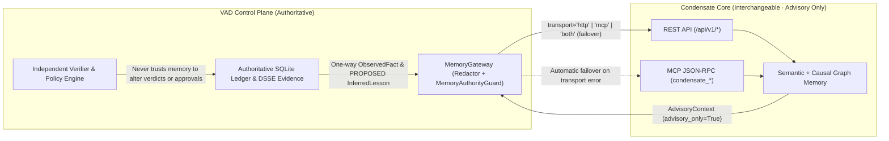

# Integration with Condensate Core

While Verified Agentic Development (VAD) provides the authoritative control plane and governance loop for software delivery, `condensate-io/core` (Condensate Core) serves as the reference external memory engine behind VAD's `MemoryProviderProtocol`.

Integrating VAD with Condensate Core allows subsequent tasks to retrieve advisory historical knowledge while preserving a strict boundary between **authoritative VAD evidence** and **interchangeable, advisory memory**:

- **Observed Facts (`ObservedFact`)**: One-way, PII/secret-redacted projections of verified delivery outcomes, rejections, verification failures, policy denials, and incidents anchored by SHA-256 `source_evidence_digest` and `eip_digest`.
- **Inferred Lessons (`InferredLesson`)**: Candidate recommendations (`review_status="proposed"`) extracted from run outcomes and incidents that require explicit human review (`vad lessons approve`) before influencing policy or proof planning.
- **Advisory Retrieval (`AdvisoryContext`)**: Scoped queries returning historical facts and human-approved lessons (`advisory_only=True`), backed by Condensate Core's semantic search, causal graph, contradiction resolution, context consolidation, and provenance traversal capabilities.

For the full provider abstraction and alternative backends (`null`, `local`, `mem0`, `graphiti`, `custom_http`, `custom_mcp`), see [memory-providers.md](file:///c:/LocalProjects/condensate-arch-docs/verified-agentic-development/docs/memory-providers.md) and [authority-boundaries.md](file:///c:/LocalProjects/condensate-arch-docs/verified-agentic-development/docs/architecture/authority-boundaries.md).

---

## Architecture & Authority Boundary



### Non-Negotiable Boundary Rules

1. **One-Way Projection Only**: Condensate Core receives redacted `ObservedFact` projections (`authoritative_source="vad"`) and `PROPOSED` `InferredLesson` candidates through `LearningLoopPublisher` and `MemoryGateway`.
2. **Never Mutates Authoritative State**: Condensate Core never alters `VerificationResult` records, grants approvals, overrides `ReleaseDecision` outcomes, or writes to authoritative VAD SQLite tables (`run_evidence`, `approvals`, `work_items`, `diff_proposals`, `diff_apply_records`, `operator_intents`).
3. **Zero SDK Coupling in Core Packages**: Core packages (`vad/verify/`, `vad/policy/`, `vad/evidence/`, `vad/release/`) have zero direct imports of `condensate` or any external memory SDK.
4. **Inbound Validation**: `MemoryAuthorityGuard.validate_inbound_context()` inspects every `AdvisoryContext` returned by `CondensateCoreProvider`, rejects any forbidden authority-override metadata (`approval_granted`, `verification_override`, `policy_override`, `evidence_ledger_mutation`, `release_approved`, `bypass_gate`), and ensures unapproved lessons never enter `approved_lessons`.

---

## Configuration (`MemoryProviderConfig`)

`CondensateCoreProvider` (`vad.memory.providers.condensate_core.CondensateCoreProvider`) is instantiated through `create_memory_provider()` using `MemoryProviderConfig` (`vad.memory.config`).

### Dual Transport Modes (`http`, `mcp`, `both`)

| `transport` (`MemoryTransport`) | Required Endpoint(s) | Behavior |
|---|---|---|
| `"http"` | `endpoint_url` | Sends REST requests to `/api/v1/*` routes using Python stdlib `urllib`. |
| `"mcp"` | `mcp_endpoint` | Invokes `condensate_*` MCP tools via HTTP(S) JSON-RPC `tools/call` or `stdio://` command execution. |
| `"both"` | `endpoint_url` or `mcp_endpoint` | Tries HTTP first (when `endpoint_url` is set) and automatically fails over to MCP if HTTP raises a `ConnectionError`, `OSError`, or `RuntimeError`. |

### Secret References (`auth_secret_ref`) — Never Raw Secrets

`MemoryProviderConfig.auth_secret_ref` enforces reference-only credentials and rejects raw tokens or secret markers (`sk-`, `ghp_`, `glpat-`, `xoxb-`, `bearer `, `api_key=`, `token=`, `password=`, `secret=`).

Supported prefixes:
- `env:<ENV_VAR>` (recommended, e.g., `auth_secret_ref="env:CONDENSATE_API_TOKEN"`)
- `file:<PATH>` (reads token on demand from a local file without caching raw secret material)
- `vault:<REF>` / `kms:<REF>`

Resolved tokens are sent as `Authorization: Bearer <token>` headers alongside `X-VAD-Project-ID: <project_id>`, and any accidental token appearance in error messages is scrubbed to `[REDACTED]`.

### Default Routes, MCP Tools, and `extra_endpoints` Overrides

| Operation | Default HTTP Route | Default MCP Tool | `extra_endpoints` Override Key |
|---|---|---|---|
| Health check | `GET /api/v1/health` | `condensate_health` | `"health"` |
| Record / list facts | `POST / GET /api/v1/facts` | `condensate_record_fact` / `condensate_list_facts` | `"facts"` |
| Record / list lessons | `POST / GET /api/v1/lessons` | `condensate_record_lesson` / `condensate_list_lessons` | `"lessons"` |
| Update lesson status | `POST /api/v1/lessons/{lesson_id}/status` | `condensate_update_lesson_status` | `"lesson_status"` |
| Query advisory context | `POST /api/v1/query` | `condensate_query` | `"query"` |

Overrides in `extra_endpoints` may be relative paths (resolved against `endpoint_url`) or full `http://` / `https://` URLs.

---

## Usage Example

The example below uses the implemented `MemoryProviderConfig`, `create_memory_provider`, `MemoryGateway`, `LearningLoopPublisher`, and `MemoryQuery` interfaces:

```python
from vad.feedback.publisher import LearningLoopPublisher
from vad.memory.authority_guard import MemoryAuthorityGuard
from vad.memory.config import MemoryProviderConfig, MemoryProviderKind, MemoryTransport
from vad.memory.contracts import FactType, MemoryQuery, ProposedRuleType
from vad.memory.gateway import MemoryGateway
from vad.memory.providers import create_memory_provider
from vad.memory.redaction import Redactor

# 1. Configure Condensate Core with dual transport failover and env-based auth
config = MemoryProviderConfig(
    provider=MemoryProviderKind.CONDENSATE_CORE,
    transport=MemoryTransport.BOTH,
    endpoint_url="http://127.0.0.1:8000",
    mcp_endpoint="http://127.0.0.1:8765/mcp",
    project_id="vad-demo",
    auth_secret_ref="env:CONDENSATE_API_TOKEN",
    timeout_seconds=5.0,
    fail_open_on_unavailable=True,
    extra_endpoints={
        "query": "/api/v2/memory/query",
    },
)

provider = create_memory_provider(config)
gateway = MemoryGateway(
    provider=provider,
    redactor=Redactor(),
    authority_guard=MemoryAuthorityGuard(),
    fail_open=True,
)

# 2. Discover capabilities and check health
caps = gateway.capabilities()
health = gateway.health()
print(f"Interface v{caps.interface_version} | healthy={health.healthy} | causal_graph={caps.causal_graph}")

# 3. Publish a one-way ObservedFact and a PROPOSED InferredLesson
publisher = LearningLoopPublisher(memory_gateway=gateway)
fact = publisher.publish_run_outcome(
    run_id="run-1042",
    eip_digest="d" * 64,
    evidence_digest="c" * 64,
    risk_tier="high",
    fact_type=FactType.VERIFICATION_FAILURE,
    summary="Token expiry boundary test failed for user alice@internal.local",
    domain_tags=["auth", "tokens"],
)

candidate_lesson = publisher.publish_candidate_lesson(
    title="Add auth token expiry boundary proof obligation",
    recommendation="Require security and unit proofs covering token clock-skew expiry.",
    proposed_rule_type=ProposedRuleType.PROOF_OBLIGATION,
    derived_from_fact_ids=[fact.fact_id],
    domain_tags=["auth", "tokens"],
    confidence=0.88,
)

# 4. Retrieve advisory context (only human-approved lessons enter approved_lessons)
context = gateway.retrieve_advisory_context(
    MemoryQuery(
        query_text="auth token expiry",
        domain_tags=["auth"],
        include_unapproved_lessons=False,
        limit=10,
    )
)
assert context.advisory_only is True
print(f"Facts={len(context.facts)} | Approved lessons={len(context.approved_lessons)} | Degraded={context.degraded}")
```

---

## Graceful Offline Degradation

External memory is strictly **advisory and optional**. When `fail_open_on_unavailable=True` (the default on `MemoryProviderConfig`) and `MemoryGateway(..., fail_open=True)`:

- **`query()` / `retrieve_advisory_context()`**: If both HTTP and MCP endpoints are unreachable, `CondensateCoreProvider` and `MemoryGateway` return an empty `AdvisoryContext(provider_name="condensate_core", facts=[], approved_lessons=[], advisory_unapproved_lessons=[], degraded=True, degraded_reason=..., advisory_only=True)`.
- **`health()`**: Returns `ProviderHealth(healthy=False, provider_name="condensate_core", detail=...)` without raising.
- **`publish_fact()` / `publish_lesson()`**: `MemoryGateway` catches transport errors when `fail_open=True` and returns `None` so verification, policy evaluation, release decisions, and authoritative ledger persistence never block on memory availability. (Authority violations via `MemoryAuthorityViolationError` still fail closed and always raise.)
