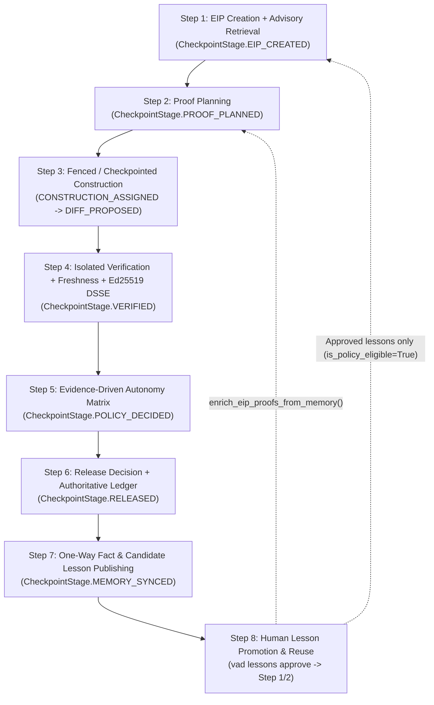

# Verified Delivery Flow

The **Verified Delivery Flow** is VAD's closed-loop, 8-step governance lifecycle from intent capture through independent verification, evidence-driven release decisions, one-way memory projection, human lesson promotion, and independent audit replay.

Every transition is anchored by cryptographic digests, monotonic checkpoints (`RunCheckpoint` across `CheckpointStage`), and strict separation between **authoritative VAD ledger state** and **advisory memory providers**.

---

## End-to-End 8-Step Flow



---

### Step 1: EIP Creation + Advisory Retrieval

- **Authoritative Intent**: A change request or incident is formalized into a canonical, digest-pinned Executable Intent Package (`EIP` in `vad.contracts.models`) with `compute_eip_digest(eip)`.
- **Advisory Context**: `MemoryGateway.retrieve_advisory_context(MemoryQuery(...))` queries the configured `MemoryProviderProtocol` (`null`, `local`, `condensate_core`, `mem0`, `graphiti`, `custom_http`, or `custom_mcp`) for relevant `ObservedFact` references and human-approved `InferredLesson` records (`AdvisoryContext(advisory_only=True)`).
- **Offline Tolerance**: If no external memory is configured or the provider is offline (`fail_open_on_unavailable=True`), VAD continues cleanly with an empty `AdvisoryContext`.
- **Checkpoint**: `CheckpointStage.EIP_CREATED`.

### Step 2: Proof Planning

- **Obligation Mapping**: `ProofObligation` items (`ProofKind`: `unit`, `property`, `contract`, `security`, `performance`, `policy`, `release`, `telemetry`, `manual_gate`) are mapped into a digest-pinned `ProofPlan` (`vad.proof.plan`, `vad.proof.mapper`).
- **Regression Enrichment**: `enrich_eip_proofs_from_memory(eip, memory_gateway)` appends regression obligations from retrieved `approved_lessons` where `lesson.is_policy_eligible` is `True` and `proposed_rule_type == ProposedRuleType.PROOF_OBLIGATION` (marking `independent_execution_required=True`). Unapproved lessons are never promoted into proof obligations.
- **Checkpoint**: `CheckpointStage.PROOF_PLANNED`.

### Step 3: Fenced / Checkpointed Construction

- **Work Assignment & Leases**: Work items are assigned to agent execution hosts under monotonic lease `fence_token` enforcement (`vad.control_plane.leases`), `IdempotencyRecord` deduplication (`vad.control_plane.idempotency`), and durable `RunCheckpoint` persistence (`vad.control_plane.checkpoints`). Stale or zombie writers receive a `409` conflict.
- **Non-Authoritative Builder Claims**: Diff proposals (`diff-proposals`) and builder test summaries (`BuilderClaim(authoritative=False)`) never count as authoritative verification.
- **Checkpoints**: `CheckpointStage.CONSTRUCTION_ASSIGNED` → `CheckpointStage.DIFF_PROPOSED`.

### Step 4: Isolated Independent Verification + Freshness + Ed25519 DSSE Attestation

- **Isolated Execution**: `vad.verify.isolated_executor` runs proof commands in an offline snapshot sandbox or disposable container, producing an `IndependentVerificationResult` stamped with `eip_digest`, `proof_plan_digest`, `commit_sha`, `tree_hash` (`compute_tree_hash`), `env_digest` (`compute_env_digest`), `builder_actor`, `verifier_actor`, and `assurance_achieved`.
- **Actor Separation**: For `A2_INDEPENDENT` and above, `verifier_actor` must differ from `builder_actor`.
- **Freshness Validation**: `FreshnessValidator.validate()` (`vad.verify.freshness`) verifies `eip_digest` and `proof_plan_digest` parity, head commit and workspace tree hashes, environment digests, dependency-change invalidation, clock skew (`MAX_FUTURE_CLOCK_SKEW_SECONDS = 60.0`), and tier `FreshnessPolicy` TTLs (`86400s` low, `14400s` medium, `3600s` high, `900s` critical).
- **Ed25519 DSSE Attestation**: `DSSEAttestor` (`vad.review.dsse_attestation`) with `LocalEd25519KeyProvider` (`vad.signing.ed25519_local`) signs and verifies in-toto DSSE attestation envelopes (`DSSEEnvelope`) bound to commit digests (`strict=True` rejects legacy hardcoded HMAC secrets).
- **Checkpoint**: `CheckpointStage.VERIFIED`.

### Step 5: Evidence-Driven Autonomy Matrix Policy Evaluation

`AutonomyMatrixEvaluator` (`vad.policy.autonomy_matrix`) evaluates `AutonomyEvaluationInput` across `RiskTier`, `AssuranceLevel`, `PolicyStage` (`build`, `ci_cd`, `deploy`, `runtime`, `drift`), freshness, drift detection, separation of duties, and optional OPA Rego cross-checks (`policies/vad.rego`):

| `RiskTier` | Required `AssuranceLevel` | Independent Verifier | Human Approval | Explicit Pre-Run Auth | Required Distinct Signoffs (`AutonomyMatrixRule`) | `AllowedAutonomyAction` |
|---|---|---|---|---|---|---|
| `low` | `A1_BASIC` | No | No | No | `0` | `autonomous_merge` |
| `medium` | `A2_INDEPENDENT` | Yes (`verifier != builder`) | No | No | `1` | `independent_verification_required` |
| `high` | `A3_ATTESTED` | Yes (`verifier != builder`) | Yes (≥1 distinct guardian evaluated) | No | `2` | `human_approval_required` |
| `critical` | `A4_RESTRICTED` | Yes (`verifier != builder`) | Yes (≥2 distinct guardians evaluated) | Yes (`explicit_authorization_ref`) | `2` | `restricted_execution_authorization` |

Any drift, stale evidence, failed verification, insufficient assurance, builder self-approval, or missing signoff fails closed with a deterministic `block_reason_code` (`blocked_drift`, `blocked_stale_evidence`, `blocked_insufficient_assurance`, `human_approval_required`, `restricted_authorization_required`, or `denied_policy`).

- **Checkpoint**: `CheckpointStage.POLICY_DECIDED`.

### Step 6: Authoritative Release Decision + Ledger Recording

- `ReleaseDecisionEngine.decide()` (`vad.release.decision`) produces an immutable, replayable `ReleaseDecision` bound to `run_id`, `eip_digest`, and `evidence_digest` with a canonical `ReleaseOutcome`:
  - Allowed outcomes: `autonomous_release`, `approved_with_human`, `approved_restricted`.
  - Fail-closed block outcomes: `human_approval_required`, `restricted_authorization_required`, `blocked_stale_evidence`, `blocked_insufficient_assurance`, `blocked_drift`, `denied_policy`.
- Authoritative artifacts (`run_evidence`, `approvals`, `release_decisions`, `checkpoints`) are persisted in VAD's SQLite ledger (`ServerStore`).
- **Checkpoint**: `CheckpointStage.RELEASED`.

### Step 7: One-Way Fact / Lesson Publishing

- `LearningLoopPublisher` (`vad.feedback.publisher`) projects redacted run outcomes as `ObservedFact` records (`authoritative_source="vad"`, anchored by `source_evidence_digest` and `eip_digest`) and emits candidate `InferredLesson` items with `review_status=LessonReviewStatus.PROPOSED` via `MemoryGateway` (`Redactor` + `MemoryAuthorityGuard`).
- When attached to `ServerStore`, `publish_candidate_lesson()` also writes a `LessonPromotionRecord` (`review_status="proposed"`) to VAD's authoritative SQLite ledger.
- **Checkpoint**: `CheckpointStage.MEMORY_SYNCED`.

### Step 8: Human Lesson Promotion & Retrieval on Subsequent Similar Tasks

- Candidate lessons remain **non-policy-eligible** until an authorized human reviewer (`ALLOWED_REVIEWER_ROLES = {"release_guardian", "operator"}`) promotes or rejects them through `LessonReviewService` (`vad.feedback.lesson_review`).
- Promotion updates VAD's authoritative `lesson_promotions` record first, then best-effort syncs status to the memory provider (`MemoryGateway.promote_lesson(...)`). Offline memory providers never block human review decisions.
- **CLI commands**:
  - List candidate/approved lessons:
    ```bash
    vad lessons list --db .vad/control-plane/vad.sqlite3 --status proposed
    ```
  - Approve a lesson for policy/proof planning:
    ```bash
    vad lessons approve <lesson_id> --reviewer alice --role release_guardian --note "Verified against regression suite"
    ```
  - Reject a lesson:
    ```bash
    vad lessons reject <lesson_id> --reviewer alice --role operator --reason "Too broad"
    ```
- **HTTP endpoints** (`vad.server.app`): `GET /lessons`, `POST /lessons/{lesson_id}/approve`, `POST /lessons/{lesson_id}/reject`.
- On subsequent similar tasks, approved lessons (`is_policy_eligible == True`) are retrieved in **Step 1** (`AdvisoryContext.approved_lessons`) and incorporated into **Step 2** proof planning (`enrich_eip_proofs_from_memory`).

---

## Independent Operator Audit Verification

Operators can independently verify the complete integrity of any run from VAD's authoritative SQLite ledger alone—without trusting builders or external memory providers—via `verify_run_audit_trail()` (`vad.audit.verify_trail`).

### Audit Checks Performed (`AuditTrailReport`)

1. `evidence_integrity`: Recomputes `EvidenceBundle(stored.evidence).compute_hash()` and verifies parity with `stored.evidence_digest`.
2. `eip_and_proof_plan_digests`: Confirms both `eip.digest` and `proof_plan.digest` are present.
3. `actor_separation`: Confirms non-empty `builder` and `verifier` actors and enforces `builder != verifier` (except `low`-risk `A1_BASIC` runs where independent verification is not required).
4. `verification_passed`: Verifies authoritative verification passed (`evidence.verification.passed is True`).
5. `dsse_attestation`: Verifies Ed25519 DSSE cryptographic signatures (`DSSEAttestor(..., strict=True)`), predicate approval decision, and optional expected commit SHA subject binding.
6. `release_decision`: Confirms `ReleaseDecision.evidence_digest` matches the stored evidence digest, `can_release` aligns with `final_decision`, and no builder self-approval appears in `recorded_approvers` or `approval_events`.
7. `checkpoint_chain`: Verifies monotonic `fence_token` and `CheckpointStage` ordering (`STAGE_ORDER`) across all work items in the run.
8. `memory_authority`: Scans `evidence.memory_events` via `_find_forbidden_fields` to ensure no authority-override fields (`approval_granted`, `verification_override`, `policy_override`, `evidence_ledger_mutation`, `release_approved`, `bypass_gate`) entered the run.

### Running Audit Verification

- **CLI** (exits with status code `1` if `report.verified` is `False`):
  ```bash
  vad audit verify-trail <run_id> --db .vad/control-plane/vad.sqlite3 --key-dir .vad/keys --commit-sha <sha>
  ```
- **HTTP** (returns `200` when verified, `422` when any check fails):
  ```http
  GET /audit/verify-trail/{run_id}
  ```

---

## Outcome & Autonomy Metrics

`AutonomyMetricsCalculator` (`vad.audit.metrics`) computes `AutonomyMetricsReport` from the authoritative `delivery_outcomes` and `defect_links` SQLite tables (or from `DeliveryOutcomeSample` and `EscapedDefectSample` records):

- **Autonomy & Quality**: `total_changes`, `accepted_changes`, `autonomous_accepted_changes`, `autonomous_safe_pass_through_rate`, `escaped_defect_count`, `escaped_defect_rate`, `verification_false_positive_count`, `verification_false_positive_rate`
- **Recovery**: `faulted_runs`, `recovered_runs`, `recovery_success_rate`
- **Human Review Latency & Cost**: `human_review_count`, `human_review_time_median_seconds`, `human_review_time_p95_seconds`, `total_cost_usd`, `cost_per_accepted_change_usd`
- **Risk Tier Breakdown**: `breakdown_by_risk_tier` across `low`, `medium`, `high`, and `critical`

### Inspecting Outcome Metrics

- **CLI**:
  ```bash
  vad metrics autonomy --db .vad/control-plane/vad.sqlite3
  ```
- **HTTP** (exposed on both the control-plane server `vad.server.app` and analytics API `vad.ui.dashboard.analytics_api`):
  ```http
  GET /metrics/autonomy
  ```
